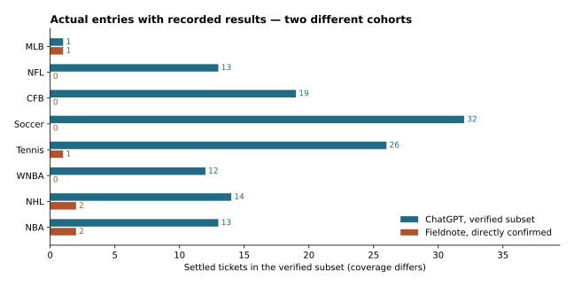
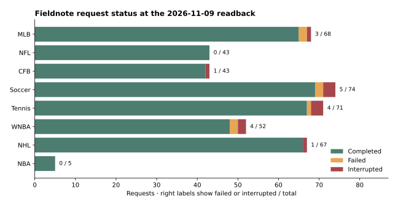
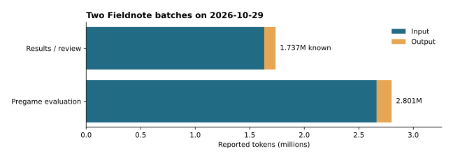

# Fieldnote operations postmortem

**November 9, 2026 · All dates and times are in America/New_York**

Fieldnote was a personal app built to preserve the context of sports analysis and reduce the work of moving handoff notes when ChatGPT conversations grew long. It maintained a persistent conversation and ledger for each sport. In practice, interrupted runs and missing entries in the analysis tables meant the user sometimes had to recheck results or rerun requests. Recommendations and price conditions also took effort to find. The user decided to stop the project after that operating experience and a loss of confidence in the analysis results.

- **Confirmed bets** — Fieldnote recorded 6 bets confirmed directly in the app. They finished 2–4 on 2.75U risked, for −0.7891U and an ROI of −28.69%. The sample spans four sports. Relative performance against ChatGPT under matched conditions remains unverified.
- **Reliability** — Of 423 recorded requests, 405 were complete, 7 failed, and 11 ended in an interrupted state. In a separate seven-sport audit, all seven raw responses were available, but the structured results initially failed the requirements for publication in the analysis tables.
- **Deployment state before shutdown** — Astra · High was the production analysis default. The status-check change that split direct API lookups from Luna · Low extraction reached the database and gateway. The web and worker releases were deferred.
- **Hosting shutdown** — On November 9, the production database and gateway backups were verified before the three Railway deployments were stopped and the Hobby subscription was canceled. The Supabase Free project was paused.

[한국어 보고서](fieldnote-postmortem.md)

## 1. Why the project started and why it stopped

The user maintained a separate ChatGPT conversation for each sport, covering pregame evaluation, lineup rechecks, bet tracking, and postgame review. Fieldnote introduced persistent sport-specific threads and a ledger to reduce the need to carry Markdown handoffs between conversations. A later goal was to show candidates and price conditions across sports in one table. During operations, the user still had to cross-check the tables against the chat and investigate missing results or interrupted runs.

## 2. What was built and how it worked in practice

| Feature | Observed benefit and limitation |
|---|---|
| Persistent threads and Markdown imports | Preserved context for eight sports. Imported historical records needed to be tracked separately from bets confirmed directly in Fieldnote. |
| Background analysis and recovery | Stored requests in the database so users could return to check their status. Some requests stalled after dispatch or ended in an interrupted state. |
| Sport-specific and consolidated tables | Let the user see candidates without switching sports. Start times and price conditions were sometimes verbose, and source matching or schema validation could leave the table out of step with the chat response. |
| Confirmed bets and postgame notes | Kept recommendations separate from user-confirmed bets. All six directly confirmed bets had supporting result evidence and calculated profit or loss. |

## 3. Analysis and bet performance

**The ChatGPT columns cover the subset of supplied records with reconcilable bet and settlement information.** The October 27 export includes 44 bet-entry documents and 97 results and review documents. Earlier handoffs also exist. The table includes only cards for which the date, bet, and outcome could be reconciled. A bet appearing in both an entry document and a review was counted once, using later corrections where available. The WNBA count uses the documented cumulative figure once. [Included dates and source identifiers](postmortem/chat-confirmed-cards.csv)

**The Fieldnote columns cover bets confirmed directly in the app with a confirmation timestamp and supporting message.** At 7:58 a.m. ET on November 9, the ledger contained 154 rows. Of these, 148 came from historical imports and six were confirmed directly on October 27–28. Imported bets were excluded from Fieldnote's performance and were not added to the ChatGPT totals. Zero means no Fieldnote bets met this definition for that sport. [De-identified ticket excerpts](postmortem/fieldnote-ticket-excerpts.csv) · [Imported row counts](postmortem/fieldnote-import-counts.csv)

| Sport | ChatGPT bets · W–L–P | Win rate | Risk · P/L · ROI | Fieldnote bets · W–L–P | Win rate | Risk · P/L · ROI |
|---|---:|---:|---:|---:|---:|---:|
| MLB | 1 · 0–1–0 | 0.00% | 0.25U · -0.2500U · Unverified | 1 · 1–0–0 | 100.00% | 0.5U · +0.3759U · 75.18% |
| NFL | 13 · 5–7–1 | 41.67% | 5.5U · -0.6480U · -11.78% | 0 | Unverified | Unverified · Unverified · Unverified |
| CFB | 19 · 10–9–0 | 52.63% | 9U · +0.8960U · 9.96% | 0 | Unverified | Unverified · Unverified · Unverified |
| Soccer | 32 · 16–16–0 | 50.00% | 14.5U · +4.3405U · 29.93% | 0 | Unverified | Unverified · Unverified · Unverified |
| Tennis | 26 · 11–15–0 | 42.31% | 10.5U · -0.4822U · -4.59% | 1 · 0–1–0 | 0.00% | 0.5U · -0.5000U · -100.00% |
| WNBA | 12 · 6–6–0 | 50.00% | Unverified · +0.5008U · Unverified | 0 | Unverified | Unverified · Unverified · Unverified |
| NHL | 14 · 4–10–0 | 28.57% | 4U · -0.8325U · -20.81% | 2 · 1–1–0 | 50.00% | 0.75U · +0.3350U · 44.67% |
| NBA | 13 · 6–7–0 | 46.15% | 5.75U · -0.9884U · -17.19% | 2 · 0–2–0 | 0.00% | 1U · -1.0000U · -100.00% |

- Win rate is wins divided by wins plus losses. ROI is result-based net profit divided by units risked. Pushes are excluded from the win rate and included in units risked. Profit and loss use the recorded stake and bet terms. Account payouts, fees, promotions, and conversion to dollars remain unverified.
- The ChatGPT MLB bet lost the full 0.25U stake, but the exact accepted odds are unavailable, so ROI is marked unverified. The 12 WNBA bets have a cumulative P/L figure but no verified total stake. A winning NFL bet from October 5 was recorded in dollars and excluded because its unit equivalent is unknown. The two NHL bets from October 27 had no verified settlement in the supplied records.
- Tennis bets with missing stakes or unverified retirement settlement terms were excluded from the P/L subset. The October 26 retirement bet uses the user's later settlement confirmation. [Exclusion and deduplication rules](postmortem/README.md)
- **Full-account performance by sport and head-to-head results at matched games, markets, and decision times remain unverified.** The two sets differ in observation dates, selections, and accepted prices. Prior simulations using public reference odds and recommended stakes were kept separate from the confirmed-bet table. [Reproducible performance data](postmortem/performance-summary.csv)

## 4. Interruptions and missing records

The November 9, 7:58 a.m. ET readback covered 423 requests created from September 23 through October 29. **18 requests (4.26%)** ended in a failed or interrupted state. The total includes 422 requests through OpenLLMS and one through the initial OpenAI route. Thirty-five requests had an attempt number of two or greater. Completed requests could still have failed earlier attempts or missing table entries. The first-attempt success rate and incident rates by root cause remain unverified. [Request counts by date and sport](postmortem/fieldnote-job-counts.csv)

| Date | What the user saw | What the logs showed and how it was handled |
|---|---|---|
| Oct 20 | Railway deployment delayed | Uploads were temporarily paused. The exact cause of the restriction remains unverified. |
| Oct 23 | NHL analysis stalled | Heartbeats continued for more than nine minutes after dispatch without a response status change. The cause of the upstream delay remains unverified. A separate storage audit found a recommendation whose event key could not be linked to the schedule. |
| Oct 23 | Some tennis evaluations were missing | The run reviewed 43 items without completing independent schedule verification. Eighteen pregame candidates remained unevaluated. |
| Oct 29 | Seven raw responses existed, but structured storage failed | CFB and WNBA lacked an evaluation block. NBA, NFL, NHL, and soccer failed schema validation. Tennis failed source URL matching. All seven saved responses were reprocessed offline to recover entries with adequate evidence. Markets with insufficient support remained unverified. |
| Oct 30 | New status checks were deferred | The database migration and gateway deployment succeeded. A subsequent Supabase read returned HTTP 522, which blocked the running-job check and deferred the web and worker rollout. |

With ChatGPT, the user read the response directly. Fieldnote also had to match games, markets, prices, and sources before saving them to a table. A failure in that step could leave a readable response in the chat and a missing candidate in the table. Tracking transport interruptions separately from storage failures made it possible to identify the user impact at each stage. [De-identified incident excerpts](postmortem/incident-excerpts.csv)

## 5. Operating cost and usability

| Measurement | Observed value | Interpretation |
|---|---|---|
| Railway, Oct 20 snapshot | About **US$2.99** in period-to-date project usage. The workspace's estimated bill was about **US$3.67**. | Interim figures. The final monthly invoice and the run rate at closeout were unverified for this report. |
| Oct 29 results and postgame review | 6 requests, 7 attempts. 1,633,107 input and 103,871 output tokens, for **at least 1,736,978 tokens**. | Token usage for one interrupted attempt remains unverified. |
| Oct 29 pregame analysis | 7 requests, 7 completed calls. 2,664,106 input and 137,208 output tokens, for **2,801,314 tokens**. | This is the batch with the seven structured-storage failures described above. |
| Weekly subscription usage | The shared account went from **45% to 58%** around the results and review batch. | This is an account-wide observation. Fieldnote's standalone share and its model cost in dollars remain unverified. |

Input accounted for most of the recorded tokens in both batches. Experiments that split result lookup from deeper review reduced usage in some cases and increased it in another comparison. Inputs and run times differed, so system-wide savings and equivalent quality remain unverified. ChatGPT required manual handoffs between sport conversations. Fieldnote required checking interruptions, retrying requests, and reconciling the chat with the tables. Time spent on these tasks was not measured. [Batch measurements](postmortem/usage-batches.csv) · [Billing snapshot](postmortem/billing-snapshot.csv)

## 6. State at closeout and lessons

- **Production settings before shutdown** — GPT-6 Astra · High was the default for evaluations and reevaluations. The November 9 check before shutdown identified the October 30 web and worker deployments as the last successful deployments. Simple status checks used the existing Astra · Medium route.
- **Partially released** — Direct API lookups, Luna · Low extraction from web material, and explicit Astra · High reevaluation were verified locally. The database and gateway changes shipped. The web and worker changes remained undeployed. Production extraction quality and usage savings remain unverified.
- **What was worth preserving** — Persistent records and evaluation rules by sport, separation of recommendations from confirmed bets, and retention of raw responses. The consolidated table was useful when it showed accurate conditions and sources and let the user find the result quickly.
- **Criteria for revisiting the project** — Compare analyses using the same pregame inputs and price snapshots. Measure how often the first request produces a usable published result, how often table rows are missing, time to recovery, and usage per request. Evaluate actual performance on comparable periods with confirmed bets and settlements.

The repository contains an archive of the last production web and worker source, reproducible aggregates, and de-identified bet and incident excerpts. The original ledgers, conversations, and private logs in full are outside the scope of this repository. The archive omits a one-off repair script tied to production targets and redacts private paths and identifiers in operational notes. Production record identifiers in the historical recovery path and its test were replaced with matching synthetic values. [Evidence and reproduction guide](postmortem/README.md)

## 7. Hosting shutdown and backup verification

**Final verification November 9, 2026 at 11:36 a.m. ET**

| Item | Verified outcome |
|---|---|
| Railway deployments | The web, worker, and gateway deployments were stopped. Railway reported `REMOVED` for all three, and the production web URL returned HTTP 404. |
| Railway volume | After backup verification, the gateway volume was detached and queued for deletion. Deletion was pending at the final check and scheduled for **November 11, 2026**. |
| Railway Hobby | Cancellation was confirmed for the AllinSimple Edge workspace. The subscription ends on **November 26, 2026**. Previously accrued usage may appear on the final invoice. The final amount remains unverified. |
| Supabase | The Free project was paused. The dashboard showed it as paused, and the CLI reported `INACTIVE`. The dashboard lists **December 14, 2027** as the deadline to resume the project. |

Before shutdown, an **81,304,960-byte** dump of the production database was saved. The archive contained schemas and data, including Auth and Storage, and was restored into an isolated Supabase PostgreSQL **17.6.1.166** instance. The restore completed without errors, and the counts below matched between production and the restored copy.

| Record type | Production | Isolated restore |
|---|---:|---:|
| Messages | 861 | 861 |
| Analysis jobs | 423 | 423 |
| Ledger rows | 154 | 154 |
| Postgame review notes | 172 | 172 |
| Queued or running analysis jobs | 0 | 0 |
| Auth users | 1 | 1 |
| Storage buckets | 0 | 0 |
| Storage objects | 0 | 0 |

The gateway backup separately preserved **four volume files** containing SQLite data and secret configuration. Each file's SHA-256 matched its source, and the copied SQLite database returned `ok` on its integrity check. The database dump, gateway backup, and verification receipts are kept in access-restricted local storage.

The restore check covered the database schema and data. Bringing the service back online requires separately applying global roles, object ownership and grants, and the Supabase project and authentication settings.
