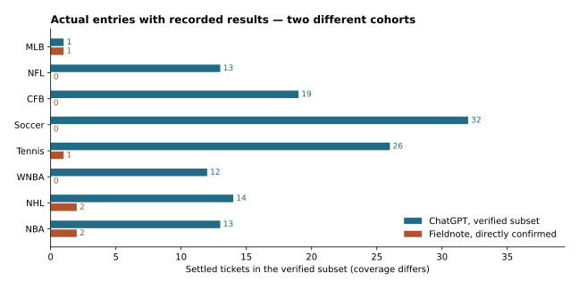
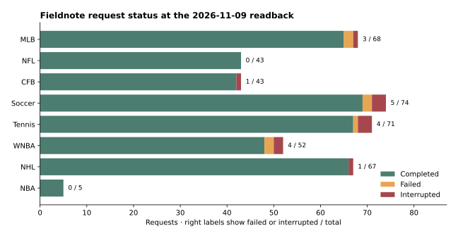
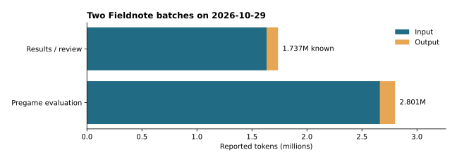

# Fieldnote 운영 종료 보고서

**작성일 2026-11-09 · 날짜 기준 America/New_York**

Fieldnote는 스포츠별 분석 맥락을 보존하고, ChatGPT 대화가 길어질 때 인계 문서를 옮기는 수고를 줄이기 위해 만든 개인용 앱이다. 종목별 대화와 장부를 유지할 수 있었지만, 연결 중단과 분석표 누락으로 결과를 다시 확인하거나 요청을 재실행해야 했다. 추천과 가격 조건을 찾는 데도 손이 갔다. 사용자는 이 운영 경험과 분석 성과에 대한 신뢰 부족을 이유로 프로젝트를 중단하기로 했다.

- **실제 진입 성적** — Fieldnote 직접 진입 6건에서 2승 4패, 2.75U 투입, −0.7891U, ROI −28.69%를 기록했다. 네 종목의 소표본이다. 같은 조건에서의 ChatGPT 대비 우위는 **미확인**이다.
- **운영 안정성** — 저장된 요청 423건의 최종 상태는 완료 405건, 실패 7건, 중단 11건이다. 별도 7종목 감사에서는 원문 응답이 모두 있었으나 분석표용 구조화 결과가 최초 저장 요건을 통과하지 못했다.
- **종료 전 배포 상태** — 운영 분석 기본값은 Astra · High였다. 상태 확인을 API 직접 조회와 Luna · Low로 분리하는 변경은 DB와 게이트웨이까지 반영됐고, 웹과 작업자 배포는 보류됐다.
- **호스팅 종료** — 11월 9일 운영 DB와 게이트웨이 백업을 검증한 뒤 Railway 배포 3개를 종료하고 Hobby 구독을 취소했다. Supabase Free 프로젝트는 일시 중지했다.

[English version](fieldnote-postmortem.en.md)

## 1. 시작한 이유와 중단 결정

사용자는 스포츠별 ChatGPT 대화에서 경기 평가, 라인업 재확인, 실제 진입과 복기를 관리했다. 대화가 길어질 때마다 정리한 MD를 새 대화로 옮기는 비용을 줄이려고 Fieldnote에 종목별 지속 대화와 장부를 만들었다. 이후 전체 분석표에서 모든 종목의 후보와 가격 조건을 곧바로 읽을 수 있게 하는 목표가 추가됐다. 실제 운영에서는 표와 채팅을 오가며 판단을 대조해야 했고, 누락된 결과나 중단된 작업을 확인하는 부담이 생겼다.

## 2. 구현과 실제 사용 경험

| 기능 | 운영에서 확인한 효과와 한계 |
|---|---|
| 종목별 지속 대화와 MD 가져오기 | 8개 종목의 맥락을 보존했다. 가져온 과거 기록을 앱에서 직접 확인한 진입과 분리해야 했다. |
| 백그라운드 분석과 복구 | 요청을 DB에 보관하고 페이지를 떠난 뒤에도 상태를 다시 읽을 수 있었다. 일부 작업은 전송 후 응답 확인이 지연되거나 연결 중단으로 끝났다. |
| 종목별·전체 분석표 | 종목을 오가지 않고 후보를 볼 수 있었다. 시작 시각과 가격 조건이 장문이 되거나, 출처 연결과 구조 검증 문제로 채팅 답변과 표가 어긋났다. |
| 실제 진입과 오답노트 | 추천과 사용자 확인 티켓을 분리했다. 직접 확인한 6건에 결과 근거와 계산 손익을 남겼다. |

## 3. 분석 성적 비교

**ChatGPT 열은 제출된 통합 원문에서 진입과 정산을 대조할 수 있었던 부분집합이다.** 2026-10-27 통합본의 실제 진입 문서 44개와 결과·오답노트 97개가 검색 범위다. 인계본에는 더 이른 기록도 있지만, 날짜·티켓·결과가 함께 확인된 카드만 아래에 담았다. 같은 티켓을 진입 문서와 오답노트에서 반복한 경우 한 번만 셌고, 후속 정정을 우선했다. WNBA는 원문에 명시된 누적 집계를 한 번 반영했다. [포함 날짜 및 원문 식별 번호](postmortem/chat-confirmed-cards.csv)

**Fieldnote 열은 앱에서 사용자 확인 시각과 근거 메시지가 저장된 직접 진입이다.** 11월 9일 07:58 ET 기준 장부 154행 중 148행은 과거 문서에서 가져온 기록이고, 직접 진입은 10월 27~28일 확인된 6건이다. 가져온 기록은 앱의 성적에 귀속하거나 ChatGPT 기록과 합산하지 않았다. 0건은 이 기준으로 저장된 티켓이 0이라는 뜻이다. [비식별 티켓](postmortem/fieldnote-ticket-excerpts.csv) · [가져온 행 수](postmortem/fieldnote-import-counts.csv)

| 종목 | ChatGPT 건수 · 승–패–푸시 | 승률 | 위험액 · 손익 · ROI | Fieldnote 건수 · 승–패–푸시 | 승률 | 위험액 · 손익 · ROI |
|---|---:|---:|---:|---:|---:|---:|
| MLB | 1건 · 0–1–0 | 0.00% | 0.25U · -0.2500U · 미확인 | 1건 · 1–0–0 | 100.00% | 0.5U · +0.3759U · 75.18% |
| NFL | 13건 · 5–7–1 | 41.67% | 5.5U · -0.6480U · -11.78% | 0건 | 미확인 | 미확인 · 미확인 · 미확인 |
| CFB | 19건 · 10–9–0 | 52.63% | 9U · +0.8960U · 9.96% | 0건 | 미확인 | 미확인 · 미확인 · 미확인 |
| 축구 | 32건 · 16–16–0 | 50.00% | 14.5U · +4.3405U · 29.93% | 0건 | 미확인 | 미확인 · 미확인 · 미확인 |
| 테니스 | 26건 · 11–15–0 | 42.31% | 10.5U · -0.4822U · -4.59% | 1건 · 0–1–0 | 0.00% | 0.5U · -0.5000U · -100.00% |
| WNBA | 12건 · 6–6–0 | 50.00% | 미확인 · +0.5008U · 미확인 | 0건 | 미확인 | 미확인 · 미확인 · 미확인 |
| NHL | 14건 · 4–10–0 | 28.57% | 4U · -0.8325U · -20.81% | 2건 · 1–1–0 | 50.00% | 0.75U · +0.3350U · 44.67% |
| NBA | 13건 · 6–7–0 | 46.15% | 5.75U · -0.9884U · -17.19% | 2건 · 0–2–0 | 0.00% | 1U · -1.0000U · -100.00% |

- 승률은 승 ÷ (승 + 패), ROI는 결과 기준 순손익 ÷ 투자 유닛으로 계산했다. 푸시는 승률 분모에서 제외하고 투자 유닛에 포함했다. 표의 손익은 기록된 위험액과 체결 조건으로 계산했다. 계좌 지급액, 수수료, 프로모션, 달러 환산은 미확인이다.
- MLB ChatGPT 티켓은 0.25U 전액 손실을 확인했으나 정확한 체결가가 없어 ROI를 미확인으로 표시했다. WNBA는 확인 12건의 누적 손익은 있으나 전체 위험액 합계가 없다. NFL의 10월 5일 달러 단위 1승은 U 환산이 미확인이라 표에서 제외했다. NHL의 10월 27일 진입 2건은 제출본에서 결과 미확인이다.
- 테니스에서 위험액이 없는 티켓과 기권 시 실제 계약 정산이 미확인인 티켓은 손익 비교 부분집합에서 제외했다. 10월 26일 기권 건은 후속 사용자 정산 확인을 반영했다. [제외·중복 기준](postmortem/README.ko.md)
- **종목별 전체 계좌 성적과 동일 경기·시장·시점의 실제 진입 성과 차이는 미확인이다.** 두 열은 관측 기간, 선택한 경기, 체결 가격이 다르다. 과거에 공개 참고배당·권장 유닛을 적용한 추천 시뮬레이션은 이 표와 분리했다. [재계산용 성적표](postmortem/performance-summary.csv)

## 4. 장애와 기록 누락

2026-09-23~10-29 ET에 생성된 요청 423건을 11월 9일 07:58 ET에 읽었다. 최종 실패·중단은 **18건(4.26%)**이다. OpenLLMS 경로 422건과 초기 OpenAI 경로 1건이 포함된다. 작업 시도 번호가 2 이상인 요청은 35건이다. 완료 상태에도 이전 시도의 실패나 표의 누락이 포함될 수 있다. 전체 기간의 첫 시도 성공률과 원인별 장애 발생률은 미확인이다. [일자·종목별 요청 집계](postmortem/fieldnote-job-counts.csv)

| 시점 | 사용자에게 보인 문제 | 로그로 확인한 사실과 조치 |
|---|---|---|
| 10/20 | Railway 배포 보류 | 업로드가 일시 중단됐다. 제한의 정확한 원인은 미확인이다. |
| 10/23 | NHL 분석 정체 | 요청 전송 뒤 9분 이상 heartbeat가 갱신됐지만 응답 상태는 바뀌지 않았다. 업스트림 지연의 원인은 미확인이다. 별도 저장 감사에서는 추천의 경기 키가 일정과 연결되지 않았다. |
| 10/23 | 테니스 평가 일부 누락 | 43개 항목을 검토했지만 독립 일정 검증을 완료하지 못했고, 경기 전 후보 평가 18건이 미완료였다. |
| 10/29 | 일곱 종목의 원문 응답은 생성됐으나 구조화 저장 실패 | CFB·WNBA는 평가 블록 누락, NBA·NFL·NHL·축구는 스키마 검증 실패, 테니스는 출처 URL 연결 실패였다. 저장 응답 7건을 오프라인에서 재처리해 표시 가능한 부분을 보정했다. 근거가 부족한 시장은 미확인으로 남겼다. |
| 10/30 | 새 상태 확인 적용 보류 | DB 마이그레이션과 게이트웨이 반영 후 Supabase 읽기에서 HTTP 522가 발생했다. 실행 중 작업 확인이 막혀 웹·작업자 배포를 보류했다. |

ChatGPT에서는 사용자가 답변을 직접 읽었다. Fieldnote는 답변을 보여주는 동시에 경기·시장·가격과 출처를 연결해 표로도 저장했다. 이 추가 단계가 실패하면 원문을 읽을 수 있어도 표에서는 후보가 빠졌다. 연결 중단과 구조화 실패를 각각 기록해야 실제 원인과 사용자 영향을 확인할 수 있다. [비식별 장애 로그 발췌](postmortem/incident-excerpts.csv)

## 5. 운영 비용과 사용성

| 측정 대상 | 확인값 | 해석 |
|---|---|---|
| Railway 10/20 조회 | 해당 과금 기간의 프로젝트 누적 사용량 환산 약 **US$2.99**. 당시 워크스페이스 예상 청구액 약 **US$3.67** | 중간 조회값이다. 월 마감 실청구액과 종료 시점 월비용은 미확인이다. |
| 10/29 결과 확인·오답노트 | 6요청·7시도, 입력 1,633,107 + 출력 103,871 = **최소 1,736,978토큰** | 중단된 시도 1회의 토큰은 미확인이다. |
| 10/29 경기 평가 | 7요청·7회 완료 호출, 입력 2,664,106 + 출력 137,208 = **2,801,314토큰** | 위 구조화 저장 실패가 확인된 경기 평가 배치다. |
| 구독 주간 사용량 | 결과 확인 배치 전후 공용 계정 사용률 **45% → 58%** | 계정 전체 변동이다. Fieldnote 단독 사용 비중과 모델 비용의 달러 환산은 미확인이다. |

두 배치 모두 입력이 기록 토큰의 대부분을 차지했다. 결과 조회와 심층 복기를 나눈 실험에서는 일부 사례에서 사용량이 줄었지만, 별도 비교에서는 늘었다. 실행 시점과 입력이 달라 전체 운영의 절감과 동등한 분석 품질은 미확인이다. ChatGPT에서는 종목별 인계본 이동, Fieldnote에서는 중단 확인·재시도·표와 대화 간 대조에 각각 수작업이 들었다. 두 방식의 실제 소요 시간은 미측정이다. [배치 집계](postmortem/usage-batches.csv)

## 6. 중단 시점의 상태와 교훈

- **종료 전 운영 설정** — 경기 평가와 재평가 기본값은 GPT-6 Astra · High였다. 11월 9일 종료 전 조회에서 10월 30일 웹·작업자 배포가 마지막 성공 배포였다. 단순 상태 확인은 Astra · Medium을 사용했다.
- **부분 반영** — API 직접 조회, 웹 자료 Luna · Low 추출, 명시적 재평가 Astra · High 설계는 로컬 검증을 마쳤다. DB·게이트웨이까지 반영됐으며 웹·작업자는 미배포다. 운영 환경에서 Luna 추출 품질과 사용량 절감은 미확인이다.
- **보존할 가치가 있었던 기능** — 종목별 기록과 기준의 지속성, 추천과 실제 진입의 분리, 원문 응답 보존이다. 전체 분석표의 가치는 조건과 출처를 정확히 연결하고 사용자가 결과를 빨리 찾을 수 있을 때 생긴다.
- **재개를 판단할 기준** — 같은 사전 입력과 가격 시점으로 분석을 비교한다. 첫 요청부터 읽을 수 있는 결과까지의 게시 성공률, 표 누락률, 복구 시간, 요청당 사용량을 함께 측정한다. 실제 성적은 체결과 정산이 확인된 동일 기간 티켓으로 평가한다.

저장소에는 마지막 운영 웹·작업자 소스의 보관본, 재계산용 집계, 비식별 티켓·장애 로그 발췌를 함께 둔다. 원본 장부·대화와 비공개 로그 전체는 로컬 보관 범위다. 게시본에서 운영 대상이 고정된 일회성 복구 스크립트를 제외하고 운영 문서의 경로와 식별자를 가렸다. 과거 복구 경로와 그 테스트에 들어 있던 생산 레코드 식별자는 동일한 가상 값으로 치환했다. [근거 및 재현 방법](postmortem/README.ko.md)

## 7. 호스팅 종료와 백업 검증

**최종 확인 2026-11-09 11:36 ET**

| 항목 | 확인 결과 |
|---|---|
| Railway 배포 | 웹·작업자·게이트웨이 배포 3개가 모두 종료됐다. Railway에서 모두 `REMOVED`로 확인했고, 운영 웹 주소는 HTTP 404를 반환했다. |
| Railway 볼륨 | 백업 검증 후 게이트웨이 볼륨을 분리하고 삭제를 예약했다. 최종 확인 시점에는 삭제 대기 상태였으며 예정일은 **2026-11-11**이었다. |
| Railway Hobby | AllinSimple Edge 워크스페이스에서 구독 취소를 확인했다. 구독 종료일은 **2026-11-26**이다. 이미 발생한 사용량은 최종 청구에 반영될 수 있으며 최종 청구액은 미확인이다. |
| Supabase | Free 프로젝트를 일시 중지했다. 대시보드는 중지 상태를, CLI는 `INACTIVE`를 표시했다. 대시보드에 표시된 재개 기한은 **2027-12-14**다. |

서비스 종료 전에 운영 DB 덤프 **81,304,960바이트**를 확보했다. Auth와 Storage를 포함한 스키마와 데이터가 담긴 아카이브를 격리된 Supabase PostgreSQL **17.6.1.166** 환경에서 복원했다. 복원은 오류 없이 끝났고, 아래 건수는 운영 DB와 복원본에서 일치했다.

| 대조 항목 | 운영 DB | 격리 복원본 |
|---|---:|---:|
| 메시지 | 861 | 861 |
| 분석 작업 | 423 | 423 |
| 장부 행 | 154 | 154 |
| 오답노트 | 172 | 172 |
| 대기·실행 중 분석 작업 | 0 | 0 |
| Auth 사용자 | 1 | 1 |
| Storage 버킷 | 0 | 0 |
| Storage 객체 | 0 | 0 |

게이트웨이는 SQLite 데이터와 비밀 설정이 들어 있는 볼륨 파일 **4개**를 별도로 보존했다. 모든 파일의 SHA-256이 원본과 일치했고, 복사본에서 SQLite 무결성 검사 결과가 `ok`였다. DB 덤프와 게이트웨이 백업, 검증 영수증은 접근이 제한된 로컬 경로에 보관했다.

복원 검증 범위는 DB 스키마와 데이터다. 재가동하려면 전역 역할, 객체 소유권과 권한, Supabase 프로젝트 설정과 인증 구성을 별도로 적용해야 한다.
