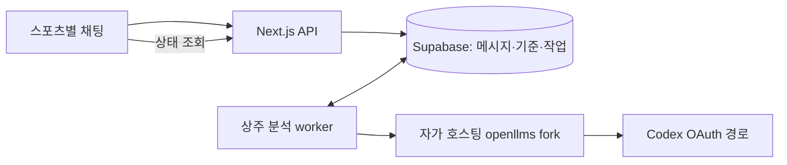

# Sports Desk: openllms 전환 설계

상태: 설계안. Codex 계정 연결, 자격증명 추출, 유료 API 호출, 게이트웨이 설치는 아직 하지 않았다.

## 결정과 목표

- 기존 스포츠별 대화, MD 원문과 추출 기록, 채택 기준, 베팅 장부는 Supabase에 그대로 보존한다.
- 분석 실행 경로를 OpenAI API 직접 호출에서 **자가 호스팅 openllms 게이트웨이의 Codex OAuth 경로**로 바꾼다. hosted openllms 서비스는 사용하지 않는다.
- 이 앱의 기본 분석 모델은 `gpt-6-astra`, 초기 분석·재평가 effort 기본값은 `high`, 결론 변경 없는 상태 확인은 `medium`이다. 초기 분석과 재평가는 명시적으로 `xhigh`를 설정할 수 있다. 지원되지 않으면 명시적으로 실패하며 다른 모델이나 유료 API로 자동 전환하지 않는다. 유료 fallback은 후속 작업으로 미룬다.
- 브라우저를 닫아도 작업을 실행·기록하도록 앱 전용 상주 worker를 둔다. 모델의 검색 결과에 유효한 출처가 없으면 검증된 분석으로 표시하지 않는다.

## 확인된 호환성 차이

검토 기준 openllms 커밋: [`7694570`](https://github.com/goodtekxyz/openllms/tree/76945701e6822512ca7370d5583db6822e16eb83).

| 요구 | 현재 openllms 동작 | 전환에 필요한 조치 |
| --- | --- | --- |
| 웹 검색 | `web_search` function shim을 Codex hosted 도구로 바꾸고 live 검색을 활성화할 수 있다. [도구 변환](https://github.com/goodtekxyz/openllms/blob/76945701e6822512ca7370d5583db6822e16eb83/internal/proxy/codex_tools.go) | 요청에 검색 도구와 `llms.web_search.mode: "live"`를 넣고 실제 검색 완료 이벤트를 확인한다. |
| 백그라운드 | 공개 API는 `/chat/completions`를 제공한다. Responses create/retrieve나 `background: true`는 제공하지 않는다. [라우트](https://github.com/goodtekxyz/openllms/blob/76945701e6822512ca7370d5583db6822e16eb83/internal/httpserver/server.go#L134-L141) | Next.js 요청은 DB에 작업만 넣고 202를 반환한다. 별도 worker가 게이트웨이 스트림을 끝까지 소비한다. |
| effort | 현재 브리지가 `reasoning_effort`를 읽거나 upstream `reasoning.effort`로 전달하지 않는다. [브리지](https://github.com/goodtekxyz/openllms/blob/76945701e6822512ca7370d5583db6822e16eb83/internal/proxy/codex_bridge.go) | 고정 버전 fork에서 명시적 effort 전달과 지원값 검증을 추가한다. 프롬프트의 “깊게 생각해”로 대체하지 않는다. |
| 출처 | 검색 action은 일부 보존하지만 최종 메시지의 `url_citation` annotations와 검색 source 목록은 현재 Chat Completions 결과에 충분히 전달되지 않는다. | fork가 source 목록과 annotations를 구조화해 반환하게 한다. worker는 URL·검색 완료 상태를 검사한다. |
| 완료 판정 | 현재 parser는 `response.incomplete`를 completed와 같은 분기로 처리하며, terminal 이벤트 없는 EOF도 성공처럼 끝날 수 있다. [parser](https://github.com/goodtekxyz/openllms/blob/76945701e6822512ca7370d5583db6822e16eb83/internal/proxy/codex_bridge_parse.go) | `response.completed`를 명시적으로 받은 경우만 성공. failed/incomplete/cancelled/연결 끊김은 구분해 전달한다. |
| 모델 목록 | discovery 실패 시 정적 fallback이 보일 수 있어 목록만으로 계정의 Astra 지원을 증명할 수 없다. [catalog](https://github.com/goodtekxyz/openllms/blob/76945701e6822512ca7370d5583db6822e16eb83/internal/modelcatalog/catalog.go) | 연결 후 Astra/effort/검색을 실제로 소규모 검증하고 결과를 기록한다. |

## 실행 구조

1. API는 기존 `request_key`로 요청을 중복 제거하고, 사용자 메시지와 `queued` 작업을 저장한 뒤 바로 202를 반환한다. 웹 요청에서 모델을 호출하지 않는다.
2. worker가 DB에서 작업을 원자적으로 claim하고 현재 채택 기준, 진행 경기, 최근 대화, 관련 기록·요약을 조합한다. MD에서 가져온 과거 사실은 계속 과거 기록으로 표시한다.
3. worker는 게이트웨이의 `chat/completions` 스트림을 호출한다. 요청에는 Astra, 지정 effort, hosted 웹 검색, `tool_choice: required`를 포함한다. 앱의 provider adapter가 이 게이트웨이 전용 형식을 담당한다.
4. worker는 검색 완료 이벤트, 출처 URL, upstream terminal status, 답변, 토큰 사용량을 수집한다. 성공과 검증 미완료를 구분한다. 출처·확인 시각·미확인 사항을 기존 UI에 표시한다.
5. DB finalizer가 현재 attempt의 성공 결과만 assistant 메시지로 한 번 저장한다. 기존 추천과 실제 진입의 분리, 경기 시작 뒤 과거 판단 불변 규칙은 유지한다.

## 작업·재시도 규칙

- `analysis_jobs`에 `provider`, `model`, `effort`, `current_attempt_id`, lease/heartbeat, 마지막 오류를 기록하고, 별도 attempt 이력에 시작·종료·사용량·출처 검증 상태를 둔다.
- worker는 lease와 fencing token으로 중복 결과 게시를 막는다. DB의 작업 및 assistant 메시지 중복 방지는 유지한다.
- 네트워크 단절 후에는 upstream 실행 여부를 확인할 retrieval API가 없다. 이런 경우 `interrupted / 실행 여부 미확인`으로 보존하고 **자동 재실행하지 않는다**. 명시적 재시도에는 구독 사용량이 중복 소모될 수 있음을 표시한다.
- 확실한 사전 연결 오류만 제한적으로 자동 재시도한다. 429라도 짧은 속도 제한이면 재시도 시각까지 기다린다. 구독량 소진은 `waiting_quota`, 인증 실패는 `relogin_required`로 표시한다. 이번 버전에서 유료 API로 자동 전환하지 않는다.
- 브라우저 종료와 무관하게 worker는 계속 실행된다. 로컬 컴퓨터가 잠자거나 꺼지면 작업은 중단될 수 있다. 항상 완료가 필요한 운영 단계에서는 gateway와 worker를 같은 상주 호스트에 배포한다.

## 자격증명과 운영

- Codex 로그인은 사용자가 openllms의 OAuth 흐름에서 직접 승인한다. 현재 Codex 앱의 내부 토큰 파일을 추출하지 않는다.
- openllms 분석 route에는 승인된 Codex OAuth 계정만 연결한다. 게이트웨이 내부의 계정 failover에 유료 OpenAI API 키를 붙이지 않는다.
- OAuth refresh token은 gateway의 비밀 저장소에만 두고, 앱 서버에는 해당 route에 한정된 gateway 키와 내부 URL만 둔다. 브라우저·DB 작업 payload·로그에 토큰을 남기지 않는다.
- gateway는 기본적으로 loopback 또는 사설 네트워크에서만 접근 가능하게 한다. Supabase Auth의 단일 owner 검사와 RLS는 그대로 유지한다.
- self-host gateway 자체에 별도 종량제 요금이 없어도 Codex 구독 사용량 한도·추가 크레딧이 적용될 수 있다. [OpenAI의 Codex 사용량 안내](https://help.openai.com/en/articles/20001275/). 비공식 Codex backend 경로는 변경·차단될 수 있으므로 gateway와 앱 사이에 provider adapter를 유지한다.
- 이 경로는 공식 웹앱 API로 지원된다고 확인된 방식이 아니다. 이용 조건과 계정 사용 한도를 검토해야 하며, 장기 가용성이나 무료 사용을 보장하지 않는다.

## 단계별 완료 조건

1. **게이트웨이 검증:** fork의 effort 전달, 완료 상태, 검색 출처 보존을 fixture 테스트한다. 계정 연결 후 Astra/xhigh와 medium이 실제 지원되는지 확인한다. 이 검증이 구독 사용량이나 추가 크레딧을 쓸 수 있으므로 실행 전에 범위와 예상 사용량을 사용자에게 알린다.
2. **worker 연결:** 버튼·자유 입력이 즉시 작업 ID를 받고, 페이지를 닫았다 돌아와도 같은 작업의 진행·실패·결과가 보인다. 강제 worker 종료와 중복 요청에서 결과 메시지는 한 번만 저장된다.
3. **분석 품질:** 웹 검색 완료와 유효 출처 링크를 확인한 경우만 최신 사실로 표시한다. 출처가 없거나 응답이 incomplete이면 `EVALUATION INCOMPLETE`로 남긴다.
4. **기록 보존:** MLB MD 기준, 사용자 정정, 추천/실제 진입 분리, 다른 스포츠의 독립 기준을 기존 테스트와 UI 흐름에서 다시 검증한다.

이 문서는 전환 설계이며, 계정에서 Astra·검색이 실제로 가능한지와 비공식 경로의 장기 안정성은 아직 검증되지 않았다.
